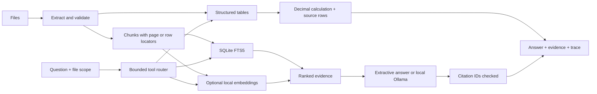

# How the agent answers

**Current default:** the Streamlit/CLI host uses local Ollama `qwen3:4b` to query the real read-only MCP server and generate a cited response. See [OLLAMA.md](OLLAMA.md) for that planner/writer workflow, file-scope enforcement, runtime setup and lifecycle. The sections below describe the underlying evidence/calculation components, still used inside MCP tools and explicit evidence-only mode.

## Ingestion

A document's ID is its SHA-256 content digest. Parsing occurs before a database transaction, so a rejected file leaves no half-indexed document. The successful transaction stores original bytes, extracted chunks, table rows and metadata. FTS5 insertion/deletion triggers keep lexical search synchronized with the chunk table. Foreign-key cascades remove chunks, vectors and tables when the document is deleted.

Text chunks overlap to preserve nearby context. PDFs keep page numbers. Tabular chunks repeat their column names and logical record numbers so the model can interpret values without seeing a full workbook. The original file remains downloadable for audit. Documents are never treated as executable code or agent instructions.

## Routing and numeric tools

The router first looks for a supported calculation with an unambiguous column and dataset. It recognizes a few documented natural-language aliases, plus source column names. An exact-year lookup requires one matching row per requested year after supported age/sex filters. Multiple matches are not silently averaged.

The numeric tool uses `Decimal`, not an LLM, to produce its result. It returns the operation, row count, column and source-row locator. It cannot execute model-authored Python or SQL. Unsupported predicates/grouping decline the tool route and use retrieval instead. This makes the agent bounded and inspectable rather than an autonomous general-purpose computer agent.

## Retrieval and generation

The lexical route builds a sanitized FTS5 expression from query tokens and ranks matches with BM25. File-scope IDs are bound SQL parameters. With an embedding model selected, the query is embedded locally, cosine-ranked against matching-model chunk vectors, and combined with lexical ranks using reciprocal-rank fusion. Scores are not probabilities or confidence estimates.

Ollama generation receives a bounded question/context and numbered evidence chunks as JSON. System instructions explicitly classify source text as untrusted data and require source citations. No model action tools are exposed. The response must contain citation IDs within the available source range; otherwise the UI falls back to quoted evidence. A valid citation ID alone does not prove the associated sentence is true.

Conversation history helps the optional generator understand context, but retrieval and the table router use the current question. Make follow-up questions explicit about the metric, file and year; automatic conversational query rewriting is not implemented. History is limited before being sent to the local model.

## MCP adapter

The optional MCP process exposes read-only tools over stdio using the official Python SDK. It shares the same index and existing retrieval/table functions as the Streamlit app. A dedicated Store subclass skips schema initialization and opens connections with SQLite mode=ro plus query_only, enforcing the no-mutation boundary.

Tool arguments are validated from type hints and bounded Pydantic fields. Results are typed structured JSON, with bounded excerpts and row pages. Numeric summaries use Decimal strings. The server does not call a model, accept arbitrary SQL/filesystem paths as tools, or expose ingestion/deletion. An MCP host launches the process and owns its lifecycle; no HTTP port is opened. See MCP.md for connection details.

## Local boundary

Streamlit and the model adapter default to loopback. The Ollama adapter accepts only local hostnames, does not follow redirects, and disables proxy environment settings. It has no cloud fallback and never pulls a model. Search/calculation works with no model server at all. A local server can itself be configured differently outside this app; users remain responsible for that configuration.

The SQLite file is plain local storage, not encrypted or multi-tenant. There is no authentication boundary between different browser sessions of the same server. Parser size limits reduce accidental resource use but are not a parser sandbox. The app is intended for local, single-user work.
