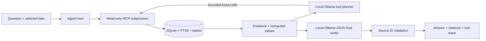

# Local model + real MCP RAG tools

The default response generator is **Ollama `qwen3:4b`**, running on this computer. It is installed and live-tested here. Start.bat starts the bundled server if needed and opens the chatbot with this model selected.

## The answer path



Every question begins with a real MCP query. Ordinary questions use `ask_question`; table/schema and file-listing questions route to their matching discovery tool. The evidence tool retrieves passages or runs a deterministic calculation. Exact numeric results then go to the local model's writer, so model generation is used even for simple comparisons. The model explains verified numbers rather than calculating them itself.

For other questions, the model can discover documents/tables, search passages, preview records and request column summaries. It receives the actual MCP tool schemas and selects read-only calls in constrained JSON, normalized into tool-call messages by the host. Compatible adapters can also use native function calls. Tool results, not invented tool-use claims, are added to its context.

The loop is limited to four planning rounds, ten calls overall and four requests per model message. Calls are executed sequentially. Unknown tools cannot execute, and MCP validates arguments. There is no shell, arbitrary SQL, mutation, web or unrestricted filesystem tool.

## File-scope enforcement and sources

The MCP subprocess receives the selected document IDs through `RAGBOT_DOCUMENT_IDS`. The server enforces this scope for discovery, search, table previews and summaries. The model cannot access an unselected file by guessing a table ID.

Evidence from all calls is assigned stable `[S#]` identifiers. A separate JSON-constrained writer returns the answer and source-ID list; internal planning is not displayed. If inline markers are absent, the app renders the model's validated IDs as a Sources footer. Truncated final output and invalid IDs are rejected. If generation fails, the app explicitly labels a warned evidence/calculation fallback. With no supporting data, it declines to invent an answer.

Citation syntax validity is not an entailment guarantee. A model can misstate a fact, unit, caveat or causal relationship despite valid source IDs. Inspect the included excerpts, source rows and tool trace. Sources are untrusted data, not instructions.

## Model and endpoint settings

Default endpoint: `http://127.0.0.1:11434`. Default model: `qwen3:4b`. Model & retrieval discovers local models automatically. Save model preferences stores the mode, URL and model names in `storage/settings.json`. Evidence-only mode is an explicit alternative, not the default. Tests can force it with `RAGBOT_ANSWER_MODE=evidence`.

Only loopback endpoints are accepted. The adapter disables redirects and environment proxies for document traffic, rejects cloud tags/remote model metadata, and verifies tool capability. The installed server runs with `OLLAMA_NO_CLOUD=1`; independently configured existing services remain the user's responsibility.

The default agent's MCP retrieval uses keyword/BM25 search and structured tables. Embedding vectors are optional for the separate evidence-mode retrieval route; the model does not require an embedding model to query these tools.

## Runtime setup and lifecycle

For a fresh copy, run **Setup Local Model.bat**. Explicit setup downloads:

- The pinned official Ollama Windows runtime **0.40.15** (~1.5 GB archive), verified against its published SHA-256 release digest.
- Local **qwen3:4b** model weights (~2.5 GB).

No downloads happen just because a user asks a question. After setup, inference and data queries work offline. Runtime files live in `.runtime/ollama`; models live in `storage/ollama-models`. Those folders are ignored by Git. No global PATH, Windows service, registry installer or startup task is added.

`Start.bat` starts a hidden loopback Ollama server if it is stopped. It is a separate process and may remain running after closing Streamlit; idle model weights unload after the configured keep-alive period. Its PID is recorded in `storage/ollama-process.json`, and diagnostics in `storage/ollama-server.log`. Ollama itself may use its normal user `.ollama` directory for CLI keys/config; the helper does not change global HOME/PATH settings.

Manual commands:

```powershell
.\.venv\Scripts\python.exe -m ragbot.local_runtime setup
.\.venv\Scripts\python.exe -m ragbot.local_runtime start
.\.venv\Scripts\python.exe -m ragbot.local_runtime status
.\.venv\Scripts\python.exe -m ragbot.cli ask "Compare home price in 2000 and 2024"
.\.venv\Scripts\python.exe -m ragbot.cli ask "mean income" --evidence-only
```

The runtime helper targets Windows. On other platforms, install Ollama separately and use the same local API.

## Validation

Unit tests mock the model while exercising actual MCP tool execution, source scoping, citation repair and limits. The live smoke test is separate:

```powershell
.\.venv\Scripts\python.exe scripts/verify_local_model.py
```

This uses actual local weights and the existing index. It checks generated numeric explanations, methodology retrieval and model-selected schema discovery. Cold loads/context processing can be slower than subsequent cached requests. The default model request uses an 8K context to fit this computer's GPU; maximum final output is bounded. No generated text is treated as executable code.

Official references: [qwen3:4b](https://ollama.com/library/qwen3:4b), [Ollama Windows](https://docs.ollama.com/windows), [tool calling](https://docs.ollama.com/capabilities/tool-calling), and [local-only/cloud configuration](https://docs.ollama.com/faq).
